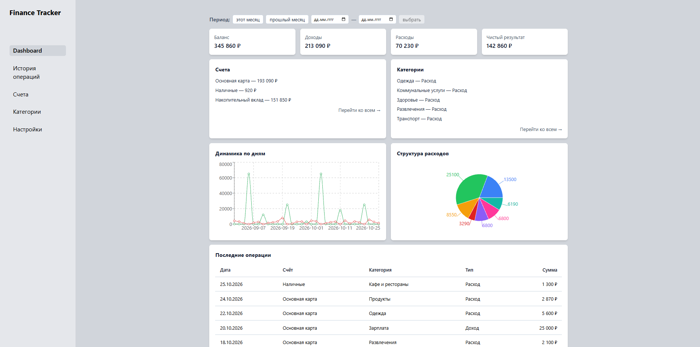
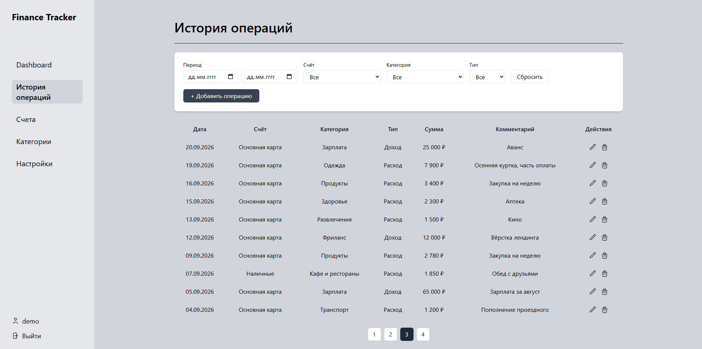
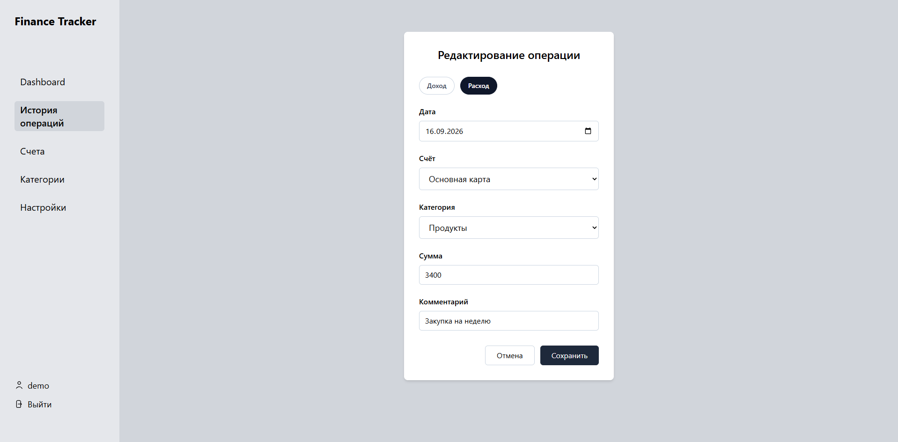
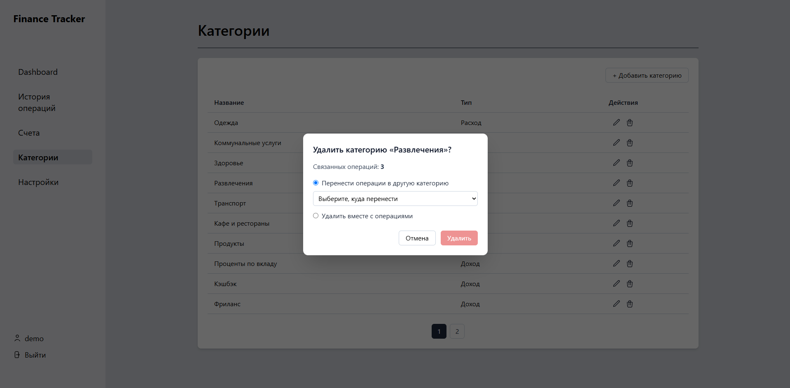

# Finance Tracker

Fullstack-приложение для учёта личных финансов. Позволяет отслеживать доходы и расходы, управлять счетами и категориями, а также анализировать финансовую активность через дашборд с графиками.

## Скриншоты

### Дашборд



### История операций



### Создание операции



### Удаление категории с переносом операций



---

## Стек технологий

**Frontend**

- React
- Redux (actions / reducers / thunks / selectors), Reselect
- React Router
- Recharts
- Tailwind CSS
- Vite

**Backend**

- Node.js
- Express
- MongoDB + Mongoose
- JWT-аутентификация (cookie-based)
- express-validator

---

## Функциональность

- Регистрация и авторизация пользователя (JWT + cookies), защита приватных страниц
- Управление счетами (создание, редактирование, удаление)
- Управление категориями доходов и расходов
- Добавление и фильтрация транзакций с автоматическим пересчётом баланса счетов
- Дашборд с аналитикой: графики (линейный, круговой), статистика по периодам
- Пагинация списков
- Централизованная обработка ошибок на сервере с корректными HTTP-статусами

---

## Структура проекта

```
finance-tracker1/
├── Backend/
│   └── src/
│       ├── controllers/   # Бизнес-логика (счета, категории, транзакции, аналитика)
│       ├── models/        # Mongoose-схемы
│       ├── routes/        # API-маршруты
│       ├── middlewares/   # Аутентификация, валидация
│       ├── mappers/       # Форматирование данных
│       └── utils/         # Вспомогательные функции и класс ошибок AppError
└── Frontend/
    └── src/
        ├── api/           # Запросы к серверу
        ├── components/    # UI-компоненты (таблицы, формы, иконки, защита маршрутов)
        ├── constants/     # Подписи для типов счетов и категорий
        ├── pages/         # Страницы приложения и их хуки
        ├── store/         # Redux: actions, reducers, thunks, selectors
        └── routes/        # Роутинг
```

---

## Запуск проекта

### Требования

- Node.js v18+
- Docker (для запуска MongoDB) — или локально установленная MongoDB / MongoDB Atlas

### 1. Клонировать репозиторий

```bash
git clone https://github.com/Sawd1edd9013/finance-tracker1.git
cd finance-tracker1
```

### 2. Запустить MongoDB

```bash
docker run -d --name finance-tracker-mongo -p 27017:27017 mongo:8
```

При следующих запусках контейнер уже создан, достаточно его включить:

```bash
docker start finance-tracker-mongo
```

Или кнопкой запуска в Docker Desktop.

### 3. Backend

```bash
cd Backend
npm install
```

Создать файл `.env` в папке `Backend`:

```env
PORT=3005
DB_CONNECTION_STRING=mongodb://localhost:27017/finance-tracker
JWT_SECRET=your_secret_key
```

```bash
npm run dev
```

Сервер запустится на `http://localhost:3005`.

### 4. Frontend

В новом терминале:

```bash
cd Frontend
npm install
npm run dev
```

Приложение откроется на `http://localhost:5173`. Запросы к `/api` проксируются на бэкенд (настройка в `vite.config.js`).

---

## API-эндпоинты

| Метод | URL                         | Описание                        |
| ----- | --------------------------- | ------------------------------- |
| POST  | /api/auth/register          | Регистрация                     |
| POST  | /api/auth/login             | Авторизация                     |
| GET   | /api/accounts               | Список счетов                   |
| POST  | /api/accounts               | Создать счёт                    |
| GET   | /api/categories             | Список категорий                |
| POST  | /api/transactions           | Добавить транзакцию             |
| GET   | /api/transactions           | Список транзакций с фильтрацией |
| GET   | /api/transactions/analytics | Аналитика по транзакциям        |

## Что улучшено после защиты

После защиты диплома я провела ревью проекта и доработала его:

- исправила баги с кэшированием данных в Redux и с пагинацией по умолчанию;
- добавила корректные HTTP-коды ошибок и валидацию всех запросов;
- сделала фильтры по периоду независимыми от часового пояса сервера;
- добавила удаление категорий с переносом или удалением связанных операций;
- исправила импорты, ломавшие сборку на Linux.

---

## Автор

Дарья Лобанова — [GitHub](https://github.com/Sawd1edd9013)

> Дипломный проект курса Frontend-разработки, Result University, 2026
